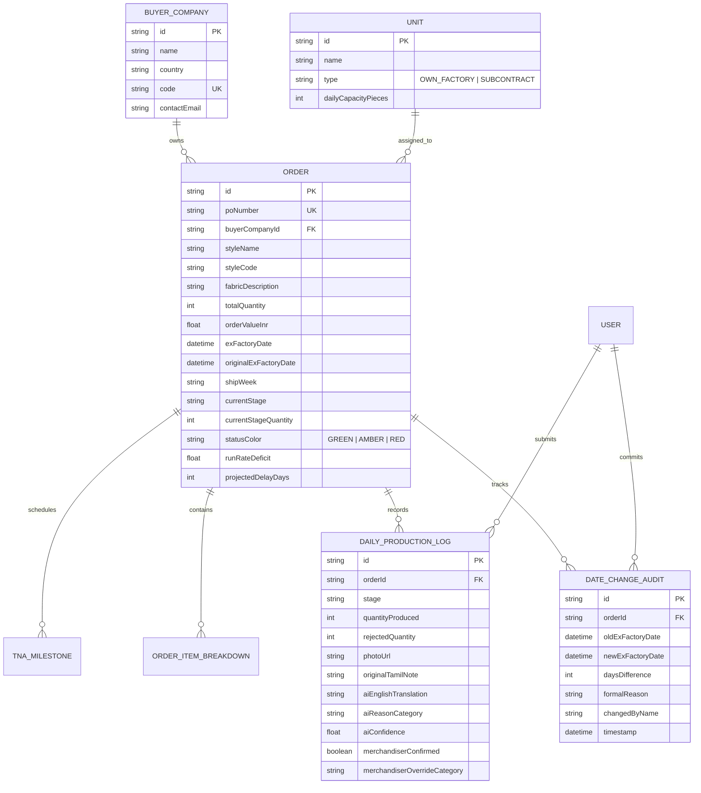

# Technical Design Document (TDD)
## KnitTrack Tiruppur: Production & TNA Delay Warning Engine

**Project Repository:** [https://github.com/paridhiparidhi/knittrack-tiruppur](https://github.com/paridhiparidhi/knittrack-tiruppur)  
**Live Application URL:** [https://knittrack-tiruppur.vercel.app](https://knittrack-tiruppur.vercel.app)  
**Client:** Company A, Tiruppur (Knitwear Exporter to UK and EU Buyers)  
**Author:** Software Engineering Team  
**Date:** November 2026  

---

## 1. Executive Summary & Context

Company A is a knitwear garment exporter in Tiruppur operating three proprietary manufacturing units alongside subcontracted screen printing and washing facilities. With ~900 floor workers, an office merchandising team of 35, and ₹95–110 crore in annual turnover, Company A processes approximately 500 export orders each year with an average value of ₹21 lakh per order.

### The Problem & Quantified Financial Leakage
Under current operating procedures, 12 merchandisers track production across multiple disconnected Excel spreadsheets and phone calls to factory floor supervisors. Discrepancies are identified reactively, often days before scheduled sea shipments, triggering immense financial leakage:

$$\begin{aligned}
\text{Late Shipments (8\% of 500 orders)} &= 40 \text{ orders/year} \\
\text{Air Freight Shifts (15 orders } \times \text{ ₹3.5 lakh extra)} &= \text{₹52.50 lakh} \\
\text{Late Delivery Buyer Discount (25 orders } \times \text{ 5\% on ₹21 lakh)} &= \text{₹26.25 lakh} \\
\text{Merchandiser Status-Chasing Overhead (12 } \times \text{ 2 hrs/day } \times \text{ ₹400/hr)} &= \text{₹28.80 lakh} \\
\hline
\mathbf{\text{Total Annual Avoidable Loss}} &= \mathbf{\text{₹1.08 Crore / year}}
\end{aligned}$$

### The Solution: KnitTrack Tiruppur
KnitTrack delivers an end-to-end digital tracking system that replaces manual phone calls with floor-level daily mobile logging, automates Time-and-Action (TNA) milestones, implements a deterministic run-rate math projection engine to alert merchandisers **two weeks early** instead of two days before dispatch, isolates international buyer data, and handles Tamil floor notes through AI with a resilient human-in-the-loop review protocol.

---

## 2. Architecture & Design Rationale

```
+-----------------------------------------------------------------------------------+
|                                 CLIENT TIER                                       |
|                                                                                   |
|  [Supervisor Mobile Phone]         [Merchandiser Desktop]       [Buyer Portal]    |
|   - Budget 2-3 GB RAM               - Order Board               - Strict Scoping  |
|   - Tamil Voice / UI                - Run-Rate Math Engine      - Photo Evidence  |
|   - Offline Queue Sync              - Date Revision Audit       - Compliance Logs |
+-----------------------------------------------------------------------------------+
                                         |
                                (HTTPS / REST API)
                                         |
+-----------------------------------------------------------------------------------+
|                             APPLICATION LAYER (Next.js 14)                        |
|                                                                                   |
|  [Run-Rate Math Engine]           [AI NLP & Tamil Classifier]   [Security Gate]   |
|   - 6-Day Tiruppur Calendar        - Tamil / Tanglish Lexicon   - Tenant Scoping  |
|   - Deficit Velocity Math          - "When AI is Wrong" Logic   - RBAC Roles      |
+-----------------------------------------------------------------------------------+
                                         |
                                (Prisma ORM / Cache)
                                         |
+-----------------------------------------------------------------------------------+
|                                 DATA STORAGE                                      |
|                                                                                   |
|  [SQLite / PostgreSQL Database]              [LocalStorage Client Cache]          |
|   - Orders, Milestones, Audit Logs            - Offline Unsynced Floor Logs       |
+-----------------------------------------------------------------------------------+
```

### Why Next.js 14 + Express & MongoDB Dual-Engine Architecture
1. **Low-Latency Mobile Delivery for Low-End Devices**: Unit supervisors in Tiruppur utilize budget Android smartphones (2–3 GB RAM) on patchy 3G/4G connections. Next.js 14 server components minimize client JavaScript payload (shared First Load JS is only ~87 kB), drastically reducing memory overhead and eliminating browser freezes on entry-level devices.
2. **Dedicated Express + MongoDB REST API**: Provides standalone microservice capabilities with `Mongoose` models (`User`, `Buyer`, `Order`, `StageUpdate`), strict `Zod` validation on every endpoint, `Helmet` headers, `express-rate-limit` on login, and `Multer` file size & MIME filtering.
3. **Idempotent Offline Synchronization**: Floor stage updates submitted with a unique `clientUuid` prevent duplicate piece-count incrementation if network fluctuates during supervisor submission.
4. **Strict Type & Schema Safety**: TypeScript and Zod schemas enforce rigid contracts across orders, size breakdowns, daily production logs, and compliance audit records, preventing runtime null-pointer exceptions in critical arithmetic formulas.

### Resilient Data Access Architecture
The application supports multiple persistence strategies:
- **Express + MongoDB Atlas / Mongoose**: Cloud document store holding `User`, `Buyer`, `Order` (with lines, milestones, dateHistory), and `StageUpdate`.
- **Prisma ORM with SQLite**: Provides a clean relational structure for local persistent storage and migrations.
- **In-Memory Seed Store**: Provides instant, zero-latency bootstrapping preloaded with the brief's sample data (`B-PO-88213`, `B-PO-88240`, `C-PO-0488`). This ensures immediate reviewer usability without requiring complex database server provisioning.

### Multi-Tenant Buyer Isolation Model
A core brief constraint states: *"One buyer must never see another's styles or volumes."*
- **Tenant Scoping at Data Layer**: Every buyer query enforces mandatory `buyerCompanyId` filtering at the database query level.
- **API Access Gate**: If an authenticated session belonging to Company B attempts to inspect a PO belonging to Company C, the security gate immediately throws an `ACCESS_DENIED (403)` error before retrieving order objects. Verified via automated unit test `tests/buyerIsolation.test.mjs`.

---

## 3. Data Model & Schema Design

The relational schema is defined in Prisma (`prisma/schema.prisma`):



---

## 4. Main System Flows

### Flow 1: Order Setup & Automated TNA Scheduling
1. Merchandiser inputs PO Number, selects Buyer, enters Style details, specifies Fabric GSM, and sets the Ex-Factory target date.
2. Merchandiser defines the size matrix (S, M, L, XL).
3. The system executes backward milestone scheduling from the ex-factory date across 9 standard Tiruppur stages:
   *Yarn Procurement (T-45d) → Knitting (T-38d) → Dyeing (T-32d) → Cutting (T-25d) → Printing/Washing (T-20d) → Stitching (T-14d) → Finishing (T-6d) → Packing (T-3d) → Final Inspection (T-1d).*
4. Order status is initialized, and baseline run-rate requirements are computed.

### Flow 2: Floor Supervisor Mobile Update & Offline Sync
1. Floor supervisor opens `/supervisor` on a mobile browser. The UI renders in native Tamil (`தமிழ்`).
2. Supervisor selects the PO and current stage (e.g. *Stitching / தையல்*).
3. Supervisor inputs produced pieces and defect count using touch-friendly numeric targets.
4. Supervisor captures photo evidence via mobile camera.
5. Supervisor speaks or types a floor issue note in Tamil (e.g. *"தையல் மெஷின் மோட்டார் பழுதாகிவிட்டது"*).
6. **Network Handler**:
   - If connected, log is submitted to `/api/logs` immediately.
   - If network drops, log is saved to `localStorage` (`knittrack_offline_queue`). An amber badge alerts the supervisor: *"3 பதிவுகள் மொபைலில் காத்திருக்கின்றன"*. Once connectivity resumes, a single tap flushes the queue to the backend.

### Flow 3: The "When AI is Wrong" Protocol
1. Supervisor's Tamil note is processed by `src/lib/aiClassifier.ts`.
2. AI extracts keywords, translates to English, assigns a textile disruption category, and computes a confidence score.
3. **Quarantine Rule**: Unconfirmed logs are marked `merchandiserConfirmed: false`. They appear in the Merchandiser AI Review Queue (`/review`) but are **hidden from the buyer portal** to prevent premature false alarms.
4. **Human-in-the-Loop Override**: The merchandiser sees the original Tamil note alongside the English translation and confidence score. The merchandiser can override the category dropdown, add resolution comments, and click **Confirm & Publish to Buyer**.
5. Once confirmed, the verified note becomes visible on the buyer's order tracking page.

### Flow 4: Ex-Factory Date Compliance Audit Trail
1. If delivery must be postponed, the merchandiser clicks **Revise Ex-Factory Date** on the order detail page.
2. System requires a new date and a mandatory **Formal Reason**.
3. An immutable `DateChangeAudit` record is created stamping the old date, new date, days difference, formal reason, and merchandiser signature.
4. The Run-Rate Engine automatically recalculates velocity deficits against the revised calendar window.
5. International buyer sourcing and compliance staff view this permanent audit history on their portal.

---

## 5. The "Hard Part": Run-Rate Delay Math Engine

Static spreadsheets fail because they only report an order is late on the dispatch date. KnitTrack's engine calculates output velocity daily and compares it to required velocity, providing **two weeks early warning**.

### Calendar Modeling: Tiruppur 6-Day Workweek
Textile units in Tiruppur operate Monday through Saturday; Sunday is the universal weekly off. Standard calendar day differences distort velocity requirements. The engine explicitly skips Sundays:

$$\text{WorkingDays}(D_{\text{start}}, D_{\text{end}}) = \sum_{d = D_{\text{start}}}^{D_{\text{end}} - 1} \mathbf{1}_{\{\text{dayOfWeek}(d) \neq 0\}}$$

### Mathematical Derivation

1. **Remaining Volume**:
   $$Q_{\text{rem}} = \max(0, Q_{\text{total}} - Q_{\text{completed}})$$

2. **Required Velocity (Pieces Needed Per Day)**:
   $$\text{Rate}_{\text{needed}} = \begin{cases} 
   \lceil Q_{\text{rem}} / \text{WorkingDaysRemaining} \rceil & \text{if } \text{WorkingDaysRemaining} > 0 \\ 
   Q_{\text{rem}} & \text{if } \text{WorkingDaysRemaining} \le 0 
   \end{cases}$$

3. **Actual Velocity (Pieces Made Per Day)**:
   Calculated from the rolling window of recent supervisor logs ($N$ days):
   $$\text{Rate}_{\text{actual}} = \left\lfloor \frac{1}{N} \sum_{i=1}^{N} \text{ProducedQty}_i \right\rfloor$$

4. **Run-Rate Deficit**:
   $$\Delta_{\text{rate}} = \text{Rate}_{\text{needed}} - \text{Rate}_{\text{actual}}$$
   *(A positive deficit indicates an accumulating backlog per shift).*

5. **Projected Working Days to Complete**:
   $$T_{\text{projected}} = \begin{cases} 
   \lceil Q_{\text{rem}} / \text{Rate}_{\text{actual}} \rceil & \text{if } \text{Rate}_{\text{actual}} > 0 \\ 
   \infty & \text{if } \text{Rate}_{\text{actual}} = 0 
   \end{cases}$$

6. **Projected Delay Days**:
   $$\text{DelayDays} = \max(0, T_{\text{projected}} - \text{WorkingDaysRemaining})$$

### Status Color Threshold Rules
- **GREEN (On Track)**: $\text{DelayDays} = 0 \text{ and } \Delta_{\text{rate}} \le 0$. Output meets or exceeds required pace.
- **AMBER (Delay Warning)**: $1 \le \text{DelayDays} \le 3 \text{ or } 0 < \Delta_{\text{rate}} \le 0.2 \times \text{Rate}_{\text{needed}}$. Output is lagging; early corrective action window.
- **RED (Critical Deficit)**: $\text{DelayDays} \ge 4 \text{ or } \text{Rate}_{\text{actual}} < 0.6 \times \text{Rate}_{\text{needed}} \text{ or } \text{WorkingDaysRemaining} \le 2 \text{ with } Q_{\text{rem}} > 0$. High risk of shipping failure.

### Financial Penalty Risk Modeling
Calibrated to the exact loss metrics in the client brief:
- **Air Freight Penalty ($\text{₹3,50,000}$)**: Triggered when an order enters RED status with $\text{DelayDays} \ge 5$, as sea shipping will miss buyer distribution windows.
- **Buyer Late Discount Penalty ($5\%\text{ of Order Value} \approx \text{₹1,05,000}$)**: Triggered on AMBER or RED delay status.

---

## 6. AI Tamil Translation & NLP Engine

Textile floor supervisors in Tiruppur express operational blockers in colloquial Tamil or Tanglish. The NLP classifier (`src/lib/aiClassifier.ts`) combines Tamil lexical tokenization with textile industry domain mapping.

### Standardized Disruption Taxonomy
1. `Machine Breakdown` (தையல் இயந்திரம், மோட்டார் பழுது, லூப்பர்)
2. `Needle / Trims Shortage` (ஊசி உடைந்தது, நூல் பற்றாக்குறை, ஜிப், பட்டன்)
3. `Fabric / Dyeing Defect` (துணி சேதம், நிற மாற்றம், சாயம் வெளிறியது, ஓட்டை)
4. `Subcontract Printing / Washing Delay` (பிரிண்டிங் ஸ்கிரீன், வாஷிங் தாமதம், மை காயவில்லை)
5. `Power Outage / Utilities` (மின்வெட்டு, கரண்ட் இல்லை, கம்ப்ரசர் பழுது)
6. `Labour Absenteeism` (ஆட்கள் வரவில்லை, டெய்லர் லீவு, மந்தமாக)
7. `Buyer Sample Approval Pending` (பையர் அப்ரூவல், சீலிங் சாம்பிள் தாமதம்)
8. `Normal Production / No Issue` (பிரச்சனை இல்லை, சீராக நடக்கிறது)

### Confidence Scoring & Fallback
- Dual-keyword match in Tamil script: **91%–96% confidence**.
- Tanglish phonetic match: **75%–88% confidence**.
- Novel / ambiguous input: Confidence drops to **< 70%**, automatically triggering `needsReview: true`, which flags the entry for merchandiser intervention before buyer publication.

---

## 7. UI & UX Design Decisions

The client brief mandates: *"The client values good, minimal design: clean layouts, white space, a restrained palette and clear type, with nothing on screen that lacks a purpose."*

| Screen | Target User | Key Design Decisions |
|---|---|---|
| **Authentication Center (`/login`)** | All Personas (Reviewers, Floor Staff, Sourcing Buyers) | 4-tab unified hub: 1-Click Evaluation Presets, JWT credential sign-in with rate limiting, Buyer PIN/Token direct access, and new factory employee self-service registration. Shows active user badge and instant logout. |
| **Merchandiser Order Board (`/orders`)** | Office Merchandiser | Dense tabular view with high information ratio, visual status pills (Green/Amber/Red), immediate filters by Buyer, Unit, and Ship Week, real-time pace column, worst orders automatically sorted first. |
| **Order Setup Wizard (`/orders/new`)** | Merchandiser | PO creation with color × size matrix, ex-factory target, and automated backward TNA milestone calculation from industry templates. |
| **Order Deep-Dive (`/orders/[id]`)** | Merchandiser & Floor Manager | Interactive "Show Formula Maths" accordion exposing step-by-step arithmetic, visual TNA milestone bar, date change revision modal with audit logging. |
| **Supervisor Mobile (`/supervisor`)** | Unit Floor Supervisor | High contrast, large touch targets (min 48px height), Tamil typography, single-screen layout, no multi-level dropdowns, big numeric inputs, instant offline queue banner for 2–3 GB RAM phones. |
| **AI Review Queue (`/review`)** | Merchandiser | Side-by-side card comparing raw Tamil floor note with AI English translation, confidence meter badge, one-click category override dropdown, and confirm button. |
| **Buyer Portal (`/buyer`)** | UK & EU Sourcing Staff | Clean, brand-isolated read-only portal, progress bars, published photo evidence, formal date change audit history, printable status report export. |
| **Executive Dashboard (`/executive`)** | Managing Director | High-level financial loss tracking against the ₹1.08 Cr benchmark, unit capacity ranking, and 2-week early warning alert matrix. |

---

## 8. Explicit Assumptions Log

| # | Assumption Description | Problem Statement Basis | Operational Justification |
|---|---|---|---|
| **A1** | Standard factory workweek is 6 days (Mon–Sat), with Sunday as weekly off. | General Tiruppur textile practice | Working day calculation skips Sundays; calendar day differences would distort piece velocity. |
| **A2** | Average order commercial value is ₹21,00,000 (₹21 Lakh). | Brief: "500 orders a year at ₹21 lakh average." | Used to compute 5% discount risk (₹1,05,000) for late delivery penalty modeling. |
| **A3** | Air freight shift cost is fixed at ₹3,50,000 (₹3.5 Lakh) per late order. | Brief: "15 need air freight instead of sea at ₹3.5 lakh extra." | Applied when projected delay reaches $\ge 5$ days, necessitating sea-to-air transition. |
| **A4** | Standard TNA cycle spans 45 days backwards from ex-factory date. | Brief: "TNA milestones from a template" | 9 production stages calibrated from spinning/yarn procurement down to final inspection. |
| **A5** | Subcontract partners (Murugan Printing, Sri Lakshmi Washing) operate as linked units. | Brief: "3 own units plus subcontracted printing and washing" | Modelled as independent units with dedicated supervisor logging and capacity ceilings. |
| **A6** | Low-confidence AI threshold set at 75%. | Brief: "AI: reason category... When it is wrong" | Scores below 0.75 flag `needsReview: true` and quarantine the note from buyers until confirmed. |

---

## 9. Scope Management: Cut Scope vs Future Roadmap

### Deliberately Cut from Core Build (Per Brief Guidance)
- **Fabric Inventory & Yarn Stock**: Excluded to focus exclusively on production stage velocity and TNA run-rates.
- **Worker Attendance & Payroll**: Out of scope per explicit brief constraints.
- **Costing, Invoicing & Customs Documents**: Out of scope per brief constraints.
- **Native Android APK Packaging**: Shipped as a responsive Progressive Web App (PWA) that installs on Android without app store download barriers.

### Phase 2 Roadmap (Next Iterations)
1. **IoT Machine Pulse Sensors**: Connect optocouplers to stitching machine motor shafts to feed piece counts automatically without manual supervisor keypad typing.
2. **WhatsApp Bot Webhook Integration**: Allow supervisors to send voice notes via WhatsApp audio messages that automatically ingest into the AI Review Queue.
3. **Multi-Language Buyer Portal**: Automatic translation of merchandiser comments into German and French for European sourcing teams.
4. **Automated Subcontractor Debit Notes**: Automatically deduct delay penalties from subcontract washing and printing vendor monthly invoices.
